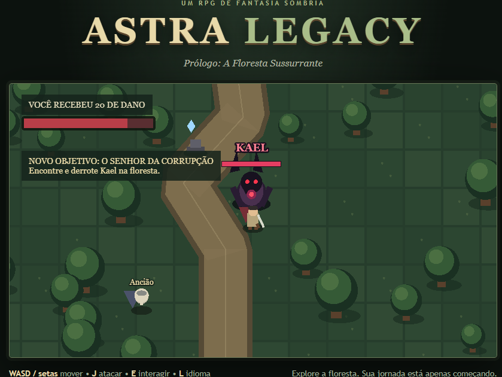

# Astra Legacy

**RPG de ação 2D de fantasia sombria**, com visão de cima, feito com Phaser 4 e TypeScript.

### [▶ Jogue agora no navegador](https://samuelpeixoto121.github.io/proj_astra_legacy/)



> O mundo foi devastado por Ignis, o Dragão das Sombras, que destruiu o Fragmento
> Central de Astra. Você chega ao Vilarejo da Alvorada no momento em que uma
> corrupção antiga começa a consumir a Floresta Sussurrante.

O **prólogo** e os **Capítulos 1, 2 e 3** estão completos e jogáveis:

- **Prólogo — A Floresta Sussurrante:** converse com o Ancião da Alvorada,
  derrote o Lobo Corrompido e enfrente Kael, o Senhor da Corrupção.
- **Capítulo 1 — O Primeiro Fragmento:** atravesse a barreira de corrupção até
  as Ruínas do Santuário, vença a Sentinela de Pedra e recupere o primeiro
  Fragmento Astral.
- **Capítulo 2 — O Segundo Fragmento:** atravesse o portal atrás do altar até o
  Pântano Sombrio, sobreviva aos Espíritos do Pântano e derrote a Feiticeira do
  Pântano para recuperar o segundo Fragmento Astral.
- **Capítulo 3 — O Terceiro Fragmento:** cruze o portal gelado até os Picos
  Congelados, escorregue pelo gelo em meio à nevasca, passe pelos Cavaleiros
  de Gelo e vença o Colosso de Gelo, um chefe de duas fases, para recuperar o
  terceiro Fragmento Astral.

## Funcionalidades

- **Movimentação em 8 direções** com colisão no cenário e câmera que acompanha o herói
- **Combate corpo a corpo** com alcance e direção do golpe, efeitos de corte,
  impacto, números de dano e barras de vida
- **Rolamento** (Shift) com invencibilidade: dá para rolar através da investida
  de Kael, para fora do golpe em área da Sentinela ou por dentro de projéteis
- **Inimigos com perseguição**: o Lobo Corrompido da missão e Aranhas Corrompidas
  espalhadas pelos mapas
- **Inimigos à distância**: Espíritos do Pântano flutuam por cima das árvores,
  mantêm distância e disparam projéteis com aviso. Os projéteis batem nas
  árvores e podem ser **rebatidos com a espada**
- **Inimigos com escudo**: os Cavaleiros de Gelo bloqueiam golpes de frente;
  é preciso atacar pelas costas ou logo depois do golpe deles, quando baixam
  a guarda
- **Quatro chefes com estilos diferentes**: Kael faz **investidas** com aviso; a
  Sentinela de Pedra **golpeia o chão em área**; a Feiticeira do Pântano ataca
  de longe com **rajadas em leque**, **teleporta** quando o herói se aproxima,
  lança **marcas sombrias** no chão e fica furiosa com metade da vida; o
  **Colosso de Gelo tem duas fases**: solta linhas de espinhos de gelo e, com
  metade da vida, a armadura se parte e vira o Espírito do Inverno, rápido,
  que lança estilhaços em círculo e avança em linha reta
- **Terreno que interfere**: poças de lama no pântano deixam o herói mais
  lento; placas de gelo nos picos fazem o herói escorregar
- **Poções de cura** (Q): inimigos às vezes deixam cair uma, chefes sempre
  deixam; o herói carrega até 3, e tocar numa Pedra Astral recarrega todas
- **Equipamentos e inventário** (Tab): cada chefe deixa um item (Lâmina
  Corrompida, Armadura de Pedra, Amuleto do Pântano, Lâmina Glacial) que muda
  os atributos e as cores do herói. O inventário tem três colunas (atributos,
  herói com os espaços em volta e mochila em grade), **raridade por cor**,
  **arrastar e soltar** e comparação dos atributos antes de trocar. Também dá
  para lutar **no soco** (sem arma) ou **sem armadura**
- **Várias áreas** ligadas por passagens, com transição de tela e o nome da área
  aparecendo ao entrar
- **Tela inicial** com Continuar / Novo jogo (com confirmação antes de apagar o
  progresso) / Idioma, fundo animado e navegação por teclado ou mouse
- **Menu de pausa** (Esc): o jogo congela por completo, com opções de som,
  idioma e volta à tela inicial
- **Sistema de missões** em etapas e **diálogos** que mudam conforme o progresso
- **Salvamento automático** e **checkpoints** (Pedras Astrais): ao ser derrotado,
  o jogador volta ao último checkpoint sem perder o progresso
- **Português e inglês**: todo o jogo e a página trocam de idioma na hora
- **Animações procedurais**: caminhada, golpe de espada e efeitos de dano
- **Herói com poses por direção**: frente, costas e perfil, montadas a partir
  de uma tabela de dados (a esquerda é o perfil espelhado)
- **Som e música gerados por código** (Web Audio API): efeitos de combate e
  música ambiente que muda por área, com tambores nas lutas contra chefes
- Todos os gráficos e sons são **criados por código**, sem imagens nem arquivos de áudio

## Controles

| Tecla | Ação |
|---|---|
| `W` `A` `S` `D` / setas | Mover |
| `J` | Atacar |
| `Shift` | Rolar (invencível durante o rolamento) |
| `Q` | Beber uma poção de cura |
| `Tab` | Inventário (equipar e tirar arma, armadura e amuleto; dá para arrastar) |
| `E` | Conversar / avançar diálogo |
| `L` | Trocar idioma (PT/EN) |
| `M` | Ligar/desligar o som |
| `Esc` | Menu de pausa (Continuar, Som, Idioma, Tela inicial) |
| `R` | Voltar ao último checkpoint (na tela de derrota) |
| `Enter` | Continuar explorando (na tela de vitória) |
| `N` | Começar um novo jogo (na tela de derrota) |

## Como rodar

Pré-requisitos: [Node.js](https://nodejs.org/) 22 ou mais recente e Git.

```bash
git clone https://github.com/SamuelPeixoto121/proj_astra_legacy.git
cd proj_astra_legacy
npm install
npm run dev
```

Depois abra **http://localhost:5173** no navegador.

| Comando | O que faz |
|---|---|
| `npm run dev` | Servidor de desenvolvimento com recarregamento automático |
| `npm run typecheck` | Verifica os tipos do TypeScript |
| `npm run build` | Verifica os tipos e gera a versão de produção em `dist/` |
| `npm run preview` | Abre a versão de produção localmente |

A cada push na branch `main`, o GitHub Actions gera o build e publica o jogo
automaticamente no GitHub Pages (`.github/workflows/deploy.yml`).

## Tecnologias

- **[Phaser 4](https://phaser.io/)**: engine de jogos 2D (renderização, física Arcade, tweens)
- **[TypeScript](https://www.typescriptlang.org/)** em modo `strict`
- **[Vite](https://vite.dev/)**: servidor de desenvolvimento e build

## Arquitetura

```
src/
├── main.ts                    Configuração do Phaser e ponto de entrada
├── config.ts                  Balanceamento: vida, dano, velocidade, checkpoints
├── types.ts                   Tipos compartilhados
├── i18n/
│   ├── texts.ts               Todos os textos em PT e EN
│   └── page.ts                Tradução da página HTML ao redor do jogo
├── scenes/
│   ├── TitleScene.ts          Tela inicial: Continuar, Novo jogo, Idioma
│   ├── PauseScene.ts          Menu de pausa, aberto por cima da área
│   ├── EquipmentScene.ts      Inventário (Tab), aberto por cima da área
│   ├── AreaScene.ts           Cena-base: herói, HUD, diálogo, combate, checkpoints
│   ├── ForestScene.ts         Floresta Sussurrante (prólogo)
│   ├── RuinsScene.ts          Ruínas do Santuário (Capítulo 1)
│   ├── SwampScene.ts          Pântano Sombrio (Capítulo 2)
│   └── PeaksScene.ts          Picos Congelados (Capítulo 3)
├── characters/                Herói, Ancião, inimigos comuns e chefes
├── world/                     Cenários, checkpoints, barreira, portal e Fragmento Astral
├── effects/                   Efeitos visuais de combate
├── audio/                     Motor de áudio, efeitos sonoros e música gerados por código
├── ui/                        Menu, painel de idioma e ícones dos itens
└── systems/
    ├── progress.ts            Progresso do jogador, compartilhado entre as áreas
    ├── preferences.ts         Preferências (idioma) guardadas fora do save
    ├── enemies.ts             Tipos de inimigos descritos por dados
    ├── projectiles.ts         Projéteis (inimigos e chefes que atacam de longe)
    ├── bosses.ts              Partes comuns dos chefes
    ├── equipment.ts           Itens, raridades e atributos do herói
    └── saveGame.ts            Salvamento no navegador
```

Algumas decisões do projeto:

- **Separação entre regras e aparência.** A cena cuida da lógica. Os personagens,
  o cenário e os efeitos ficam em módulos próprios que só desenham.
- **Textos centralizados.** Todo texto visível fica em `i18n/texts.ts`, com tipagem
  que obriga a ter as duas traduções. Trocar de idioma atualiza o jogo inteiro e,
  por meio de um evento, a página HTML, sem o jogo depender do HTML.
- **Balanceamento em um só lugar.** Vida, dano, velocidade e alcance ficam em
  `config.ts`, separados da lógica.
- **Save robusto.** O salvamento tem número de versão e é validado campo a campo
  ao carregar: um save corrompido ou antigo é ignorado em vez de travar o jogo.
- **Personagem = corpo físico + desenho.** Cada personagem tem um retângulo
  invisível com física e um desenho que o acompanha. A perseguição dos inimigos
  é uma função só, reaproveitada por todos eles e pelos chefes.
- **Inimigos orientados a dados.** Cada tipo de inimigo é um registro com
  atributos, cores, barra de vida e função de desenho (`systems/enemies.ts`).
  A cena trata todos da mesma forma: adicionar um inimigo novo não exige
  mudar a lógica de combate.
- **Cena-base para as áreas.** Herói, HUD, diálogo, combate, checkpoints e
  passagens ficam em `AreaScene`. Cada área herda dela e só descreve o próprio
  cenário, personagens e regras da missão.
- **Progresso separado das cenas.** O estado da missão fica em um módulo
  compartilhado (`systems/progress.ts`), que é o que vai para o save. Por isso
  trocar de área ou reiniciar não perde nada.
- **Chefes com estados.** Cada chefe funciona como uma máquina de estados. A
  Feiticeira, por exemplo: esperando → flutuando ⇄ conjurando / lançando marcas
  / teleportando → derrotada. Isso deixa o comportamento previsível e fácil de
  ajustar, e cria brechas claras para o jogador (ela não teleporta enquanto conjura).
- **Ataque à distância reaproveitável.** Inimigos e chefes usam o mesmo sistema
  de projéteis (`systems/projectiles.ts`); um inimigo novo que atira só precisa
  declarar os dados do tiro.

## Próximos passos

- [x] Animações do herói por direção
- [x] Novos inimigos e áreas
- [x] Capítulo 1: o primeiro Fragmento Astral
- [x] Capítulo 2: o segundo Fragmento Astral
- [x] Capítulo 3: o terceiro Fragmento Astral
- [x] Poções de cura, equipamentos e inventário
- [ ] Próximos capítulos: os fragmentos restantes e o caminho até Ignis

## Autor

Desenvolvido por **Samuel Peixoto**: [github.com/SamuelPeixoto121](https://github.com/SamuelPeixoto121)

---

### English summary

**Astra Legacy** is a top-down 2D dark fantasy action RPG built with **Phaser 4**,
**TypeScript** (strict) and **Vite**. The playable prologue and Chapters 1, 2 and 3 feature
8-direction movement, directional melee combat with visual effects, a dodge roll,
data-driven enemies (including ranged ones with deflectable projectiles and
shielded knights that block frontal attacks), **four boss fights** (a telegraphed
charge, an area slam, a teleporting sorceress with projectile volleys, and a
two-phase ice colossus), slippery ice and slowing mud, healing potions, a
drag-and-drop inventory with item rarities and stat comparison, multiple areas
with transitions, a staged quest system, dialogue, **autosave with checkpoints**,
and full **Portuguese/English** localization. All graphics, sound effects and
music are generated procedurally in code (Web Audio API) — no image or audio files.

**[Play it in your browser](https://samuelpeixoto121.github.io/proj_astra_legacy/)**,
or run it locally with `npm install` and `npm run dev`, then open http://localhost:5173.
Controls: WASD/arrows to move, J to attack, Shift to roll, Q to drink a potion, Tab for the inventory, E to interact, L to switch language, M to toggle sound, Esc for the pause menu.
